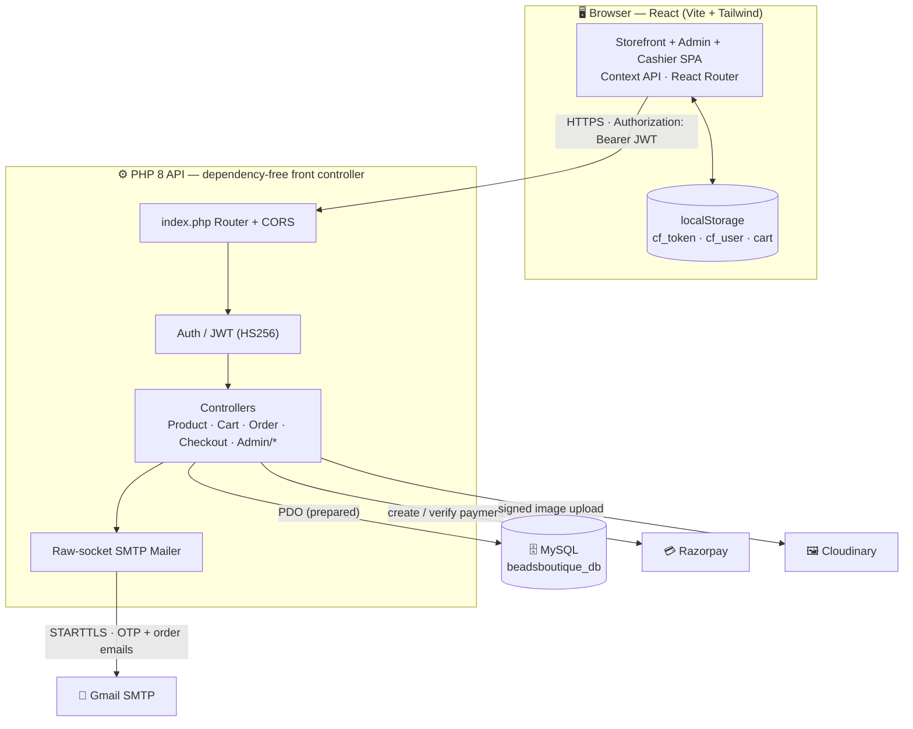
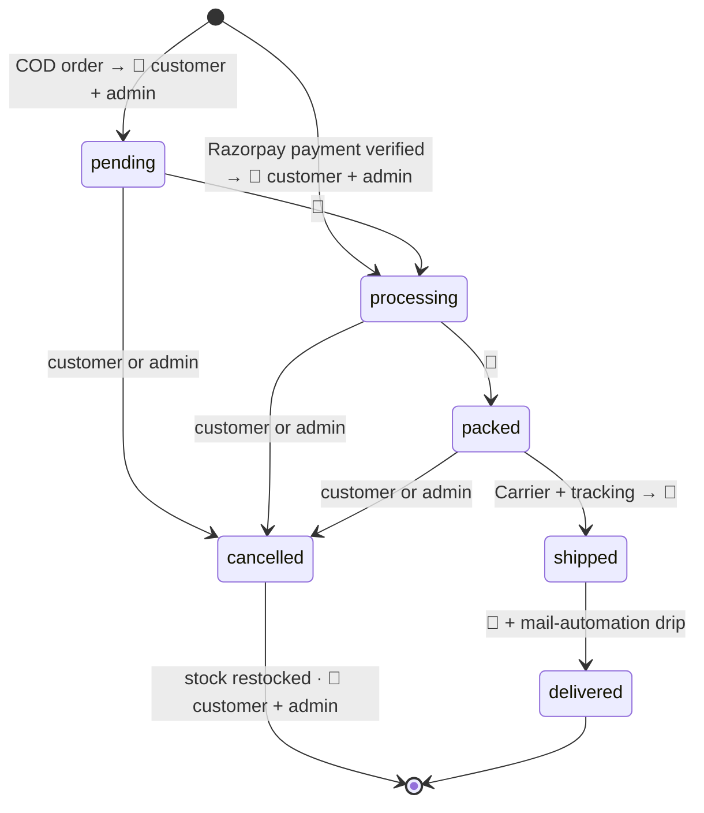

# 💎 Beadsboutique — Handcrafted Beaded Jewellery Store

A complete, production-ready **single-vendor e-commerce** web app for **Beads Boutique Jewellery**. It sells handcrafted beaded jewellery: necklaces, bracelets, earrings, bangles, harams, jhumkas, long chains, pendants and tikkas. It has a storefront for customers, an admin panel, and an in-store billing counter. All three read and write the same live MySQL database.

**Stack:** React 18 (Vite) + Tailwind CSS · PHP 8 (dependency-free) · MySQL 8 / MariaDB · JWT + Email OTP · Cloudinary (all image uploads + optimised delivery) · Gmail SMTP · Razorpay + COD

**Brand theme:** the colours come from the logo (`frontend/public/logo.png`):

| Token | Hex | Use |
|---|---|---|
| `ink` | `#3a0d14` | Deep wine: text, dark surfaces, admin sidebar |
| `gold` | `#b8745a` (light `#dba58c`, dark `#8f4f3c`) | Rose gold: buttons, accents, active states |
| `sage` | `#d9a3ae` | Blush pink highlights |
| `cream` / `luxe` | `#fdf2f2` / `#fbf4f2` | Page backgrounds |

**Support email** (the only address used for the store, SMTP sender and admin alerts): **beadsboutiquejewellery@gmail.com**

> Admin alerts go to **Admin → Settings → "Message inbox"** (`store_contact_to`), falling back to the contact email, then the first admin user. Because the sender is the same Gmail account, Gmail may file self-sent alerts under *Sent / All Mail* — set the inbox to a different address to have them land in the Inbox.

---

## 🏗️ System Architecture



---

## ✨ Features

### Customer storefront
- **Sign in / sign up** in an **iPhone (iOS) style**: grouped fields, iOS switch, 50px rounded buttons. Includes email OTP verification, forgot/reset password, and 7-day sliding sessions. There is no Google sign-in.
- **Landing page** (`/`):
  - **Hero carousel** built from admin banners. Banners are 16:9 artwork with the logo baked in, so each card keeps that ratio (nothing is cropped), has **no overlay**, and the copy sits **below** the card, never on top. On tablet/desktop the whole hero (card, copy, button, dots) fits exactly one screen. It **always auto-advances** every 4.5 s; clicking an arrow or dot restarts the countdown. The default hero background image appears **only when no banners exist**.
  - **Landing header** adapts to what is under it: no bar over the hero, a frosted maroon bar over dark sections (`data-nav="dark"`), frosted white over light sections.
  - Best sellers / new arrivals: a short list (fewer than 3 items) sits **centred** instead of as a half-empty scrolling rail. Featured collection cards also centre when there are only a few.
  - **Shop by category** rail with arch-framed images that shows "N pieces" or "Coming soon" per category.
  - Featured and trending collections.
  - Brand story with **live stats** (customers, pieces, categories, reviews, average rating) from `/api/landing`.
- **Shop and category pages** (`pages/Shop.jsx`): search, sort (price / popularity / newest / rating / discount), on-sale filter, "Load more" pagination.
  - **Sidebar filters:** Price range (placeholders show the live min/max, e.g. `₹390 – ₹4440`), then **Categories** — "All Products" plus every category with its product count. Clicking one opens `/category/<slug>`, highlights it in gold and keeps any search / sale query. The same list is in the mobile Filters drawer.
  - **Missing product photos:** a product with no uploaded image shows its **category banner** (`public/Banner/*.png`, e.g. Bangles → `Bangles.png`, Jummka → `Jhumka.png`, unknown → `Product1.png`) instead of a blank placeholder. Logic lives in `utils/productImage.js` and is shared by the product cards and the header search suggestions. Uploaded photos always take priority.
- **Header** (`components/Navbar.jsx`): live search suggestions and the profile menu use a **solid white** panel with a shadow. (They used the glass `.card` style, but a blur nested inside the navbar's own blur doesn't render, so they looked transparent over the products.)
- **Navigation:** every route change scrolls to the top (`App.jsx`), so a category opened from the footer starts at its products, not the footer.
- **Product page:**
  - 3:4 image gallery with zoom, plus a Quick View drawer.
  - Price, MRP and discount %, stock, and a returnable / free-shipping badge. The discount % is **rounded down** everywhere (backend + `utils/format.js`), so a near-total discount never shows as "-100%".
  - **Jewellery size guide** (ring, bracelet and necklace charts).
  - Reviews with rating breakdown, frequently bought together.
  - **Related products:** same category first, topped up with best-sellers / newest from the rest of the store when the category has fewer than 4. The section is hidden only when the store has no other active product.
  - **Share** (`components/ShareButtons.jsx`) — WhatsApp, Facebook, X, Instagram, copy. Every share carries the **photo, name, price / MRP / discount, a short description and the link**:
    - The shared link is the backend page `/share/product/{slug}`, which serves Open Graph tags (photo as a 1200px JPG, title, price, description) for rich previews and redirects visitors to the product. Previews only work once the site is on a public domain — WhatsApp/Facebook cannot reach `localhost`.
    - **Phones:** WhatsApp and Instagram open the native share sheet with the actual photo attached.
    - **Desktop Instagram** (no web share API): downloads the photo, copies the caption and opens Instagram.
  - "Notify me when back in stock".
  - Products have **no variants and no specifications**: one price, one MRP and one stock figure each.
- **Wishlist, compare, and cart** (live totals).
- **Checkout:**
  - Address book. The new-address form is **pre-filled with the name and phone from registration** (read live from `/api/auth/me`); the street address is entered once and saved for next time.
  - Tap-to-apply coupon chips.
  - **Live server quote** — subtotal, coupon discount, shipping, total and allowed payment methods come from `POST /api/checkout/quote` (the same pricing code that creates the order), refreshed on cart / coupon / address change, on tab focus and every 30 s.
  - Payment by **Razorpay** (card / UPI / netbanking / wallets) or **Cash on Delivery**. COD is allowed up to the admin-set limit; **limit `0` = COD for every order**.
  - If the Razorpay keys are set but rejected by Razorpay, the online option is greyed out ("Temporarily unavailable") and COD is pre-selected, instead of failing on *Pay*. The key check is cached for 5 minutes in `backend/storage/razorpay_status.json` and re-runs at once when the keys change.
  - The manual UPI-QR payment flow is no longer offered (its admin settings were removed); the backend endpoint remains for old orders.
- **Orders:**
  - Status timeline, shipment tracking, reorder, returns (RMA), post-delivery reviews.
  - **Cancel** (auto-restock) is allowed only **until the order ships** — pending / processing / packed. Once *Shipped* or *Delivered* the button is replaced by a note, and the backend refuses atomically (an admin marking it shipped at the same moment always wins). Asks for confirmation; the order page re-checks its status on focus and every 30 s.
  - Printable invoice (opens instantly; no QR block).
- **Profile:** edit details, change password, addresses, rewards, and **profile photo upload**. Photos are cropped square to 400px, stored on Cloudinary, and shown in the header and the admin panel.
- **Emails** (`core/Mailer.php`) — one light, branded design (blush page, wine header, rose-gold accents; tables + inline styles for Gmail/Outlook/phones). Order emails are rendered **from the live order row**: progress tracker, delivery address, order info, items with photos, discount, shipping, total and a "View / Track your order" button. All are sent after the HTTP response.

  | Event | Customer | Admin |
  |---|---|---|
  | Order placed — COD, Razorpay, approved UPI | ✅ Order confirmed | ✅ New order (customer contact, WhatsApp link, items to pack) |
  | Status → processing / packed / shipped / delivered / cancelled | ✅ one email per change | — |
  | Carrier / tracking added to a shipped order | ✅ tracking email | — |
  | Customer cancels | ✅ cancelled (+ refund note if prepaid) | ✅ "Do not pack or ship" (+ refund reminder) |
  | Return updates | ✅ | — |

  The customer is emailed only when the status actually changes (or tracking changes on a shipped order) — re-saving the same status sends nothing. OTP, password-reset, return, UPI and automation emails use the same design.
- **Image performance:** uploads are stored as originals on Cloudinary (banners were ~2.4 MB PNGs). The API client rewrites every Cloudinary URL in **storefront** responses to `f_auto,q_auto,c_limit,w_1400` (`utils/cdn.js`), serving WebP/AVIF about **10× smaller** (homepage ≈ 38 MB → 2.9 MB). Admin responses are left untouched, so edit forms never save rewritten URLs.
- **Policy pages** (`pages/static/`): Privacy, Terms, Returns ("Cancellation and Refund Policy") and Shipping ("Shipping & Delivery Policy") hold the store-supplied text. ⚠️ Returns and Shipping still contain `[specified time, e.g., …]` placeholders — replace them with the real time limits.
- **About page** (`pages/static/About.jsx`, `/about`): image hero ("Jewellery that feels personal"), "Made in small batches" story, six promise cards, a collections grid (8 category banners linking to each category) and a "Start shopping" banner. The copy matches the real range (bangles, harams, temple necklaces, jhumkas…) — no rings/anklets.
- **Footer** (`components/Footer.jsx`): brand column with logo, tagline, **phone / email / address** (from Admin → Settings) and social icons (only those with a URL); **Shop** links (live categories) in two short columns; Company links; a pill-style newsletter field. Bottom bar: copyright left, "Designed & Developed by CloudHawk" right, with space kept clear of the WhatsApp button.
- **Floating WhatsApp button** (`components/WhatsAppButton.jsx`): a plain WhatsApp-green circle with the white logo and a soft shadow (no ring, no blinking dot). Hidden until a WhatsApp number is set in admin settings.
- Mobile bottom tab bar, PWA manifest + service worker.
- **Fully responsive** on mobile, tablet, laptop and desktop. Verified by a headless audit of every page at 375 / 768 / 1280 / 1536 px, with no horizontal overflow.

### Admin panel (`/admin`)
- **Sidebar** in wine and rose gold:
  - Collapse it to an icon rail with the **round ‹ button on its edge**. The choice is remembered in localStorage (`bb_admin_sidebar`).
  - In the icon rail, hover an icon to see its name.
  - On mobile it becomes a slide-in drawer (`inert` while closed, so focus never gets trapped off-screen).
- **Dashboard:**
  - Welcome banner with today / pending / low-stock chips.
  - KPI cards (tabular numerals) and a pulse strip.
  - Revenue chart for the last 6 months. The **Orders** series has no ₹ in its tooltip.
  - Order-status chart, top products, recent customers. Online and counter sales are combined.
- **Products:**
  - CRUD form with name, category, brand, description, price, MRP, stock and low-stock threshold.
  - Active / featured / trending / returnable / free-shipping toggles.
  - **Images:**
    - Upload **3:4 portrait**, ideally **1200 × 1600 px**.
    - Photos are resized in the browser to WebP. Off-ratio photos get a **"NOT 3:4"** badge.
    - Drag to reorder; the first image is the primary.
    - Images are uploaded to Cloudinary.
- **Bulk CSV upload:**
  - Download the template, fill it, upload it. Rows are **upserted by product name**: existing products are updated, new ones are created, and missing categories are created automatically.
  - Template columns: `name, category, price, mrp, stock, low_stock_alert, brand, description, images, active, featured, trending, returnable, free_shipping, shipping_fee`.
  - Separate multiple image URLs with `|`. Currency symbols in prices are ignored.
  - Exports include a UTF-8 BOM so Excel opens them correctly.
- **Categories:**
  - Add an image by upload **or by pasting an image URL**. Either way it is stored on Cloudinary.
  - 3:4 arch preview, description, and a "Show on store" toggle.
- **Banners, coupons, inventory** (low-stock alerts), **orders** (status workflow, tracking, "Save & notify", UPI payment approvals queue), **invoices** (online + counter in one list).
- **Customers** (CSV / Excel / PDF export), **reviews** moderation, **returns**, **loyalty** points, **messages** inbox (Contact Us).
- **Reports:** date ranges, charts, CSV export.
- **Mail automation:** a lifecycle email drip driven by order events, with editable offsets and a "Run due now" button.
- **Settings:** brand logo and name, contact details, admin alert inbox, announcement bar (**leave empty to hide it**), shipping rules, socials / WhatsApp, order prefix (`BB`), COD limit (`0` = no limit). Changes go live on the storefront without a redeploy (open tabs pick them up on refresh). The UPI / QR section has been removed.
- **Billing / POS** (`/cashier`): in-store counter with QR / barcode scan, discount, GST, cash / UPI / card / split payment, an 80mm thermal receipt, and void & restock. **Cashiers** get a login that can reach only the billing screen.

---

## 📁 Project Structure

```
Beadsboutique/
├── database/
│   ├── beadsboutique_setup.sql        # ⭐ Fresh install: creates beadsboutique_db + all tables + jewellery seed
│   ├── seed_jewellery.sql             # Jewellery categories + store settings (insert-only)
│   ├── migration_037_rebrand_beadsboutique.sql  # Rebrands an existing (older) DB's stored data
│   ├── migration_038_user_avatar.sql  # users.avatar_url → MEDIUMTEXT (profile photos)
│   └── cloudfashion.sql, migration_002…036.sql  # Legacy base schema + history
├── backend/                           # PHP API (no Composer)
│   ├── index.php / routes.php         # Front controller + all routes
│   ├── .env.example                   # Copy to .env
│   ├── config/                        # env loader, PDO database
│   ├── core/                          # Response, Jwt, Auth, Mailer, Cloudinary, Razorpay, Automation…
│   ├── controllers/                   # Auth, Product, Cart, Order, Checkout, Misc… + admin/
│   ├── storage/                       # Runtime files, web-blocked (razorpay_status.json key-check cache, logs)
│   └── scripts/migrate_images_to_cloudinary.php  # One-off: move stored base64 images to Cloudinary
└── frontend/                          # React + Vite + Tailwind
    ├── public/                        # logo.png, logo.webp, icon-64/192/512.png, manifest, sw.js
    │   └── Banner/                    # Category / hero / brand images (also the fallback for products without photos)
    ├── src/
    │   ├── api/client.js              # Axios + JWT interceptor, long timeout for image uploads, Cloudinary URL optimiser
    │   ├── utils/                     # cdn.js (image optimisation), format.js (₹, discount %), invoice.js (print),
    │   │                              # productImage.js (category-banner fallback for products without photos)
    │   ├── context/                   # Auth, Cart, Wishlist, Theme (light only), Compare, Store
    │   ├── components/                # Navbar, Footer, Logo, Avatar, ProductCard, SizeGuideModal…
    │   ├── landing/                   # Landing page sections (Hero, CategorySection, BrandIntro…)
    │   ├── pages/                     # Shop, ProductDetails, Cart, Checkout, Orders, Profile, auth/…
    │   └── admin/                     # AdminLayout, Dashboard, Products, Categories, Billing…
    └── tailwind.config.js             # Brand palette tokens
```

---

## 🚀 Quick Start (XAMPP on Windows)

> Prerequisites: XAMPP (Apache + PHP 8.1+), MySQL 8 (or MariaDB), and Node.js 18+.

### 1. Database
Open **`database/beadsboutique_setup.sql`** in MySQL Workbench and run the whole script (⚡). It creates `beadsboutique_db` with every table and the jewellery seed data.

- The script uses `CREATE DATABASE IF NOT EXISTS`, so an empty schema created earlier by Workbench is fine.
- It **fails instead of overwriting** if the tables already exist.
- If you are upgrading an older database instead, apply `migration_037_rebrand_beadsboutique.sql`, then `migration_038_user_avatar.sql`.

> The XAMPP `mysql.exe` client can't log in to MySQL 8 accounts that use `caching_sha2_password`. Use Workbench, or a PHP PDO script, instead.

### 2. Backend
```bash
cd backend
cp .env.example .env     # then fill in DB_PASS, JWT_SECRET, SMTP, Cloudinary, Razorpay
```
- API base: `http://localhost/Beadsboutique/backend`
- Check it works: open `…/backend/api/categories`. It should return `{"success":true,...}`.
- Restart Apache after editing `.env`.

> `.htaccess` files block web access to `.env`, logs, `.sql` files, dot-files and `backend/storage/` (they return **403**). Keep them in place.

### 3. Frontend
```bash
cd frontend
npm install
npm run dev              # http://localhost:5190 (strictPort)
```
`frontend/.env`:
```
VITE_API_URL=http://localhost/Beadsboutique/backend
```

### Demo logins
Create accounts through the app, then promote an admin account by setting `role = 'admin'` in the `users` table. The login screen never shows or prefills credentials.

---

## 🔑 Configuration (`backend/.env`)

| Variable | Purpose |
|---|---|
| `APP_ENV`, `APP_URL`, `FRONTEND_URL` | Environment and URLs. `FRONTEND_URL` must be the storefront's real address (`http://localhost:5190` in dev, your domain in production): it is used for email buttons, password-reset links and the share-page redirect. |
| `DB_HOST/PORT/NAME/USER/PASS` | MySQL connection (`DB_NAME=beadsboutique_db`) |
| `JWT_SECRET`, `JWT_TTL` | Token signing. **Use a long random secret.** |
| `MAIL_DRIVER` | `smtp` sends real email; `log` writes to `backend/storage/mail.log` |
| `SMTP_HOST/PORT/USER/PASS` | Gmail: `smtp.gmail.com:587`, user `beadsboutiquejewellery@gmail.com`, and a 16-character **App Password** (spaces are stripped automatically) |
| `MAIL_FROM`, `MAIL_FROM_NAME` | Sender: `beadsboutiquejewellery@gmail.com` / `Beadsboutique` |
| `CLOUDINARY_CLOUD_NAME/API_KEY/API_SECRET` | **Every** image upload (products, categories, banners, avatars, logo) is sent to Cloudinary using signed uploads. If the keys are missing, images are stored inline. |
| `RAZORPAY_KEY_ID/KEY_SECRET` | Online payments (`rzp_test_…` for sandbox, `rzp_live_…` for real money). Copy **both** from the same "Regenerate key" popup — a mismatched pair returns 401 *Authentication failed*. Empty keys = demo test mode (decided by the server only). Wrong keys never create fake paid orders: checkout refuses and hides online payment. See [RAZORPAY_SETUP.md](RAZORPAY_SETUP.md). |
| `CRON_KEY` | Secret for `GET /api/cron/run?key=…`, which runs the mail-automation drip from Task Scheduler / cron |
| `DELIVERY_*` | Optional courier API (the admin Delivery page has been removed; orders use manual carrier + tracking) |

> 🔒 Never commit `backend/.env`. If an App Password or API secret was ever committed, revoke it and create a new one.

### Moving old images to Cloudinary
```bash
php backend/scripts/migrate_images_to_cloudinary.php
```
This uploads any base64 images still stored in the database (categories, products, banners, settings) to Cloudinary and saves the returned URLs. It is safe to run more than once, and it runs from the command line only.

---

## 🗄️ Database

**28 tables** in `beadsboutique_db`, grouped by area:

| Area | Tables |
|---|---|
| Users & auth | `users`, `auth_tokens`, `addresses`, `loyalty_transactions`, `notification_states` |
| Catalogue | `categories`, `products`, `product_images`, `product_variants`, `reviews`, `stock_notifications` |
| Shopping | `cart`, `wishlist`, `recently_viewed`, `coupons` |
| Orders & delivery | `orders`, `order_items`, `order_status_history`, `returns`, `shipment_events`, `email_automations` |
| Billing / POS | `bills`, `bill_items` |
| Site content | `banners`, `settings`, `contact_messages`, `newsletter` |

### ER diagram (all 28 tables)

- **Solid lines** are real foreign keys in the database (30 in total).
- **Dotted lines** are links kept in application code only, with no FK constraint: `users.referred_by`, `email_automations.order_id`, `orders.coupon_code → coupons.code`.
- `banners`, `settings`, `contact_messages` and `newsletter` stand alone (no links).

```mermaid
erDiagram
    %% ---------- Users & auth ----------
    users ||--o{ auth_tokens : "logs in with"
    users ||--o{ addresses : has
    users ||--o{ loyalty_transactions : earns
    users ||--o{ notification_states : "admin_id"
    users |o..o{ users : "referred_by"

    %% ---------- Catalogue ----------
    categories |o--o{ categories : "parent_id"
    categories ||--o{ products : groups
    products ||--o{ product_images : has
    products ||--o{ product_variants : "has (legacy)"
    products ||--o{ reviews : receives
    users ||--o{ reviews : writes
    products ||--o{ stock_notifications : "back-in-stock"

    %% ---------- Shopping ----------
    users ||--o{ cart : holds
    products ||--o{ cart : "in cart"
    product_variants |o--o{ cart : "variant_id"
    users ||--o{ wishlist : saves
    products ||--o{ wishlist : "in wishlist"
    users ||--o{ recently_viewed : views
    products ||--o{ recently_viewed : "viewed"

    %% ---------- Orders & delivery ----------
    users ||--o{ orders : places
    addresses |o--o{ orders : "ships to"
    orders ||--|{ order_items : contains
    products |o--o{ order_items : "sold as"
    orders ||--o{ order_status_history : "status log"
    orders ||--o| returns : "may have"
    users ||--o{ returns : requests
    orders ||--o{ shipment_events : "tracking events"
    orders |o--o{ loyalty_transactions : "points for"
    orders |o..o{ email_automations : "drip emails"
    coupons |o..o{ orders : "coupon_code"

    %% ---------- Billing / POS ----------
    users ||--o{ bills : "cashier_id"
    users |o--o{ bills : "customer user_id"
    bills ||--|{ bill_items : contains
    products |o--o{ bill_items : "sold at counter"

    users {
        bigint id PK
        varchar name
        varchar email UK
        varchar phone
        varchar password_hash "bcrypt"
        enum role "customer, admin, cashier"
        tinyint is_verified
        mediumtext avatar_url "Cloudinary URL"
        enum status "active, blocked"
        int loyalty_points
        varchar referral_code UK
        bigint referred_by "users.id (app only)"
        timestamp created_at
        timestamp updated_at
    }
    auth_tokens {
        bigint id PK
        bigint user_id FK
        varchar token
        enum type "email_otp, password_reset"
        datetime expires_at
        tinyint used
        timestamp created_at
    }
    addresses {
        bigint id PK
        bigint user_id FK
        varchar full_name
        varchar phone
        varchar line1
        varchar line2
        varchar city
        varchar state
        varchar pincode
        varchar country
        tinyint is_default
        timestamp created_at
    }
    loyalty_transactions {
        bigint id PK
        bigint user_id FK
        int points
        enum type "earn, redeem, referral, signup, adjust"
        bigint order_id FK
        varchar note
        timestamp created_at
    }
    notification_states {
        bigint id PK
        bigint admin_id FK "users.id"
        varchar notif_key
        enum status "read, dismissed"
        timestamp updated_at
    }
    categories {
        bigint id PK
        varchar name
        varchar slug UK
        bigint parent_id FK "categories.id"
        mediumtext image_url
        varchar description
        tinyint is_active
        timestamp created_at
    }
    products {
        bigint id PK
        varchar name
        varchar slug UK
        bigint category_id FK
        varchar brand
        text description
        json specifications "unused"
        decimal price
        decimal mrp
        int stock
        int low_stock_alert
        decimal rating_avg
        int rating_count
        int sold_count
        tinyint is_featured
        tinyint is_trending
        tinyint is_active
        tinyint is_returnable
        tinyint is_free_shipping
        decimal shipping_fee
        timestamp created_at
        timestamp updated_at
    }
    product_images {
        bigint id PK
        bigint product_id FK
        mediumtext image_url "Cloudinary URL"
        varchar public_id "Cloudinary id"
        tinyint is_primary
        int sort_order
    }
    product_variants {
        bigint id PK
        bigint product_id FK
        varchar size
        varchar color
        varchar color_hex
        decimal price
        decimal mrp
        varchar sku
        decimal price_diff
        int stock
    }
    reviews {
        bigint id PK
        bigint product_id FK
        bigint user_id FK
        tinyint rating "1 to 5"
        varchar title
        text comment
        tinyint is_hidden
        timestamp created_at
    }
    stock_notifications {
        bigint id PK
        bigint product_id FK
        varchar email
        tinyint notified
        timestamp created_at
    }
    cart {
        bigint id PK
        bigint user_id FK
        bigint product_id FK
        bigint variant_id FK
        int quantity
        timestamp created_at
        timestamp updated_at
    }
    wishlist {
        bigint id PK
        bigint user_id FK
        bigint product_id FK
        timestamp created_at
    }
    recently_viewed {
        bigint id PK
        bigint user_id FK
        bigint product_id FK
        timestamp viewed_at
    }
    coupons {
        bigint id PK
        varchar code UK
        enum type "percentage, fixed"
        decimal value
        decimal min_order
        decimal max_discount
        int usage_limit
        tinyint first_order_only
        int used_count
        datetime expires_at
        tinyint is_active
        timestamp created_at
    }
    orders {
        bigint id PK
        varchar order_number UK "BB00001"
        bigint user_id FK
        bigint address_id FK
        json shipping_address "snapshot"
        decimal subtotal
        decimal discount
        decimal shipping_fee
        decimal total
        int points_used
        int points_earned
        varchar coupon_code "coupons.code (app only)"
        enum payment_method "razorpay, cod, upi"
        enum payment_status "pending, paid, failed, refunded"
        varchar razorpay_order_id
        varchar razorpay_payment_id
        varchar payment_txn_id
        mediumtext payment_screenshot
        enum payment_approval "none, pending, approved, rejected"
        varchar payment_note
        datetime payment_reviewed_at
        enum status "pending, processing, packed, shipped, delivered, cancelled, returned"
        varchar carrier
        varchar tracking_number
        varchar delivery_provider
        varchar shipment_id
        varchar shipment_order_id
        varchar awb_code
        varchar courier_name
        varchar shipment_status
        date shipment_eta
        varchar label_url
        varchar tracking_url
        timestamp shipment_synced_at
        timestamp placed_at
        timestamp updated_at
    }
    order_items {
        bigint id PK
        bigint order_id FK
        bigint product_id FK
        bigint variant_id "legacy, no FK"
        varchar product_name "snapshot"
        mediumtext image_url "snapshot"
        varchar size
        varchar color
        decimal price
        int quantity
        decimal line_total
    }
    order_status_history {
        bigint id PK
        bigint order_id FK
        varchar old_status
        varchar old_carrier
        varchar old_tracking
        varchar new_status
        varchar new_carrier
        varchar new_tracking
        tinyint undone
        timestamp created_at
    }
    returns {
        bigint id PK
        bigint order_id FK "unique, one per order"
        bigint user_id FK
        varchar reason
        enum status "requested, approved, rejected, refunded"
        varchar admin_note
        timestamp created_at
        timestamp updated_at
    }
    shipment_events {
        bigint id PK
        bigint order_id FK
        varchar awb_code
        varchar status
        varchar activity
        varchar location
        datetime event_at
        char fingerprint "dedupe"
        timestamp created_at
    }
    email_automations {
        bigint id PK
        bigint order_id "orders.id (app only)"
        bigint user_id
        varchar email
        varchar type
        datetime scheduled_at
        datetime sent_at
        varchar status
        varchar error
        datetime created_at
    }
    bills {
        bigint id PK
        varchar bill_number UK
        bigint cashier_id FK "users.id"
        bigint user_id FK "users.id, customer"
        varchar customer_name
        varchar customer_phone
        decimal subtotal
        decimal discount
        enum discount_type "flat, percent"
        decimal discount_value
        decimal tax_pct "GST percent"
        decimal tax_amount
        decimal total
        decimal paid
        decimal change_due
        decimal split_cash
        decimal split_digital
        enum payment_method "cash, card, upi, split"
        varchar note
        enum status "paid, void"
        timestamp created_at
        timestamp updated_at
    }
    bill_items {
        bigint id PK
        bigint bill_id FK
        bigint product_id FK
        varchar product_name
        varchar sku
        decimal price
        int quantity
        decimal line_total
    }
    banners {
        bigint id PK
        varchar title
        varchar subtitle
        varchar cta_label
        varchar cta_link
        mediumtext image_url
        int sort_order
        tinyint is_active
        timestamp created_at
    }
    settings {
        varchar key PK
        mediumtext value
        timestamp updated_at
    }
    contact_messages {
        bigint id PK
        varchar name
        varchar email
        varchar subject
        text message
        tinyint is_read
        timestamp created_at
    }
    newsletter {
        bigint id PK
        varchar email UK
        timestamp created_at
    }
```



> `product_variants` and `products.specifications` come from the CloudFashion base schema. The jewellery store doesn't use them (one price, MRP and stock per product), but they are kept so old carts and orders stay valid.

---

## 🔌 API Overview

All responses use `{ success, message, data }`. Protected routes need `Authorization: Bearer <jwt>`. Full reference: [backend/API.md](backend/API.md).

```
POST /api/auth/register · /verify-otp · /login · /forgot-password     GET /api/auth/me
PUT  /api/profile            (name, phone, avatar data-URI → Cloudinary)
PUT  /api/profile/password
GET  /api/landing            (hero copy, banners, live stats)
GET  /api/products?search=&sort=     GET /api/products/{slug}     GET /api/categories
POST /api/cart · /api/coupons/apply · /api/contact · /api/reviews
POST /api/checkout/quote     (live totals + cod_allowed + online_available)
POST /api/checkout/create-order · /api/checkout/verify · /api/orders/cod · /api/orders/upi
GET  /api/orders · /api/orders/verify/{id}?t=      POST /api/orders/{id}/return
PUT  /api/orders/{id}/cancel  (until shipped; emails customer + admin)
GET  /api/products/{slug}/related    (category first, store-wide fallback)
GET  /share/product/{slug}           (HTML: Open Graph preview → redirects to the product)

# admin
GET  /api/admin/dashboard            GET/POST/PUT/DELETE /api/admin/products
POST /api/admin/products/import      (bulk CSV upsert)
CRUD /api/admin/categories · banners · coupons · staff
PUT  /api/admin/orders/{id}/status   GET/PUT /api/admin/orders/{id}/payment
GET  /api/admin/invoices · reports/sales · loyalty · automation · messages
GET/PUT /api/admin/settings
# billing / POS (admin or cashier)
GET/POST /api/admin/billing          PUT /api/admin/billing/{id}/void
```

---

## 🔄 Order lifecycle



Customers can cancel only before **shipped**; after that only a return (post-delivery) is possible. Refunds for cancelled online payments are issued manually from the Razorpay dashboard — the admin alert states the amount.

---

## 🛠️ Tech Notes
- **State:** React Context (Auth, Cart, Wishlist, Theme, Store). The theme is light-only.
- **UI:** Tailwind brand tokens, Framer Motion, Recharts, Lucide icons, react-hot-toast.
- **Uploads:** large data-URI requests get a 120 s client timeout and clear error messages (timeout / offline / 413).
- **Security:** bcrypt, HS256 JWT, PDO prepared statements, input validation, CORS, `.htaccess` deny rules.
- **Email:** raw-socket STARTTLS mailer with RFC 2047-encoded headers. Order emails are deferred until after the HTTP response. The header shows the store logo only when it is a hosted (Cloudinary) URL — email clients block inline `data:` images — otherwise the store name.
- **Payments:** the Razorpay signature is verified against the Razorpay order id **stored for that order**, so a payment for another (cheaper) order can't be replayed.
- **Images:** `utils/cdn.js` (`cdn()` / `optimizeImages()`) is idempotent and leaves non-Cloudinary, `data:` and already-transformed URLs unchanged.

See [RAZORPAY_SETUP.md](RAZORPAY_SETUP.md) for payment-gateway setup and [backend/API.md](backend/API.md) for the full API reference.

---

## ⚠️ Pending before go-live

- **Product photos are missing.** All 127 products were added without images (`product_images` is empty), so every product currently shows its category banner. Upload real photos from **Admin → Products** (edit each product) or with **Bulk CSV upload** using the `images` column (URLs separated by `|`; existing products are updated by name, not duplicated).
- **Phone number is a placeholder.** `+91 98765 43210` is the code default shown in the footer. Set the real phone and address in **Admin → Settings**.
- **Policy placeholders.** Returns and Shipping pages still contain `[specified time, e.g., …]` text.
- **About page claims.** Check the six promise cards (materials, "Delivered across India", "Secure payments") match the business.

---

## 📝 Changelog

### 2026-10-21 — Storefront polish
- **Branding:** store name / page title changed to "Beadsboutique Jewellery"; hero eyebrow is now "Handcrafted Jewellery".
- **Landing page:** 16:9 hero cards with copy below, always auto-advancing; one-screen hero on desktop; adaptive landing header (hero / dark / light); centred layouts for short best-seller, new-arrival and featured lists; radial-gradient glows instead of blurred boxes (no hard edges); "necklace" category link fixed.
- **Collection page:** product cards and search suggestions fall back to the category banner when a product has no photo; price inputs no longer cut off; new **Categories** filter under Price Range with counts and active highlight.
- **Header:** search suggestions and profile menu are now solid (were see-through over product cards).
- **WhatsApp button:** simplified to a clean green circle.
- **Footer:** redesigned — contact details, two-column category links, pill newsletter field, split bottom bar clear of the WhatsApp button.
- **About page:** rebuilt with hero, story, promise cards, collections grid and CTA; copy corrected to the real product range.

### Earlier
Everything described in **Features** above: storefront, checkout (Razorpay + COD), orders and emails, admin panel, bulk CSV, Cloudinary images, billing / POS, and the rebrand from the CloudFashion base (`migration_037`).

---

## 📄 License
MIT. Built for **Beads Boutique Jewellery**.
