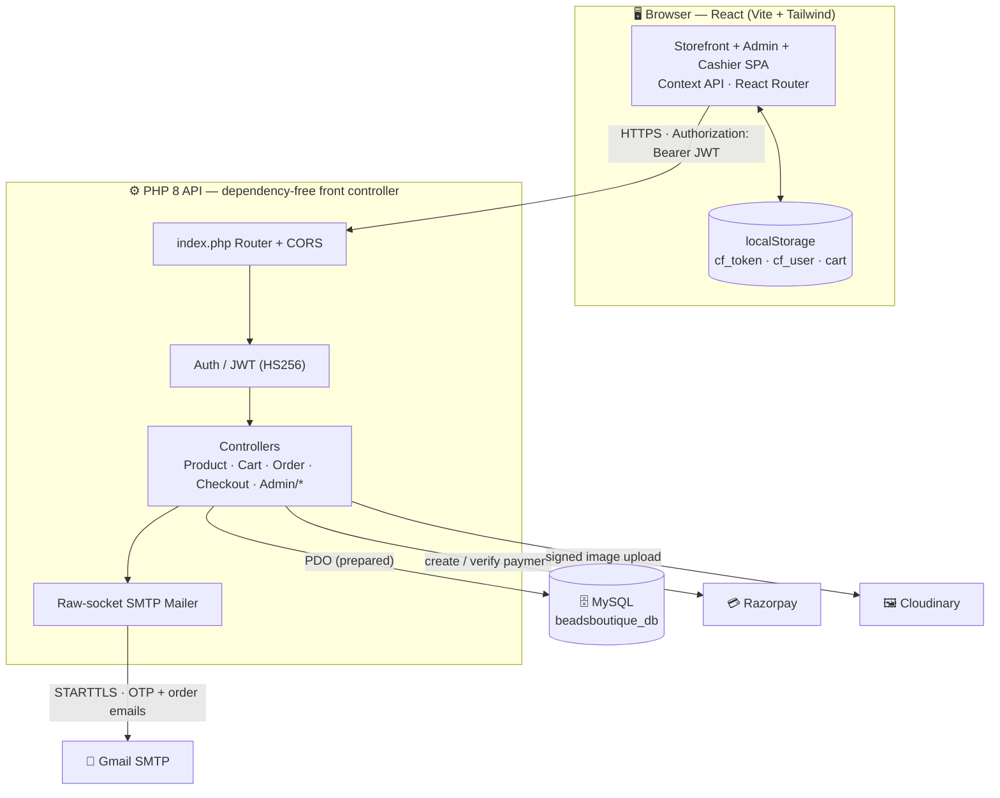
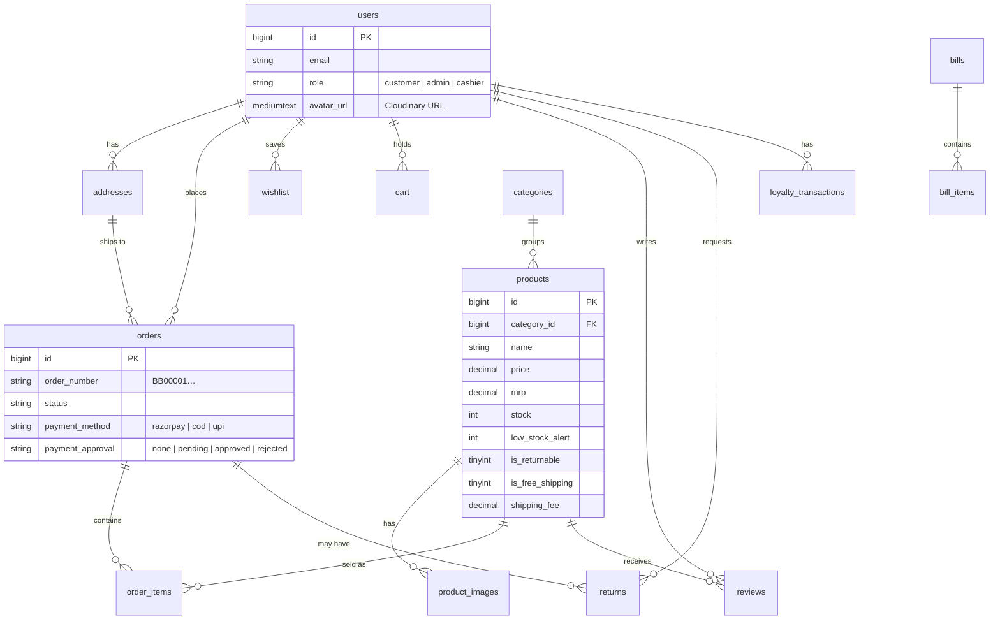
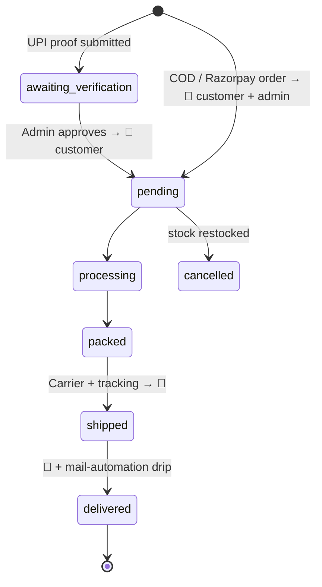

# 💎 Beadsboutique — Handcrafted Beaded Jewellery Store

A complete, production-ready **single-vendor e-commerce** web app for **Beads Boutique Jewellery**. It sells handcrafted beaded jewellery: necklaces, bracelets, earrings, bangles, harams, jhumkas, long chains, pendants and tikkas. It has a storefront for customers, an admin panel, and an in-store billing counter. All three read and write the same live MySQL database.

**Stack:** React 18 (Vite) + Tailwind CSS · PHP 8 (dependency-free) · MySQL 8 / MariaDB · JWT + Email OTP · Cloudinary (all image uploads) · Gmail SMTP · Razorpay + UPI/QR (admin-verified) + COD

**Brand theme:** the colours come from the logo (`frontend/public/logo.png`):

| Token | Hex | Use |
|---|---|---|
| `ink` | `#3a0d14` | Deep wine: text, dark surfaces, admin sidebar |
| `gold` | `#b8745a` (light `#dba58c`, dark `#8f4f3c`) | Rose gold: buttons, accents, active states |
| `sage` | `#d9a3ae` | Blush pink highlights |
| `cream` / `luxe` | `#fdf2f2` / `#fbf4f2` | Page backgrounds |

**Support email** (the only address used for the store, SMTP sender and admin alerts): **beadsboutiquejewellery@gmail.com**

---

## 🏗️ System Architecture



---

## ✨ Features

### Customer storefront
- **Sign in / sign up** in an **iPhone (iOS) style**: grouped fields, iOS switch, 50px rounded buttons. Includes email OTP verification, forgot/reset password, and 7-day sliding sessions. There is no Google sign-in.
- **Landing page** (`/`):
  - **Hero carousel** built from admin banners. The default hero background image appears **only when no banners exist**.
  - **Shop by category** rail with arch-framed images that shows "N pieces" or "Coming soon" per category.
  - Featured and trending collections.
  - Brand story with **live stats** (customers, pieces, categories, reviews, average rating) from `/api/landing`.
- **Shop and category pages:** search, live facet filters (category, brand, price), sort (price / popularity / newest / rating / discount), on-sale filter, pagination.
- **Product page:**
  - 3:4 image gallery with zoom, plus a Quick View drawer.
  - Price, MRP and discount %, stock, and a returnable / free-shipping badge.
  - **Jewellery size guide** (ring, bracelet and necklace charts).
  - Reviews with rating breakdown, frequently bought together, related products.
  - Share buttons, and "notify me when back in stock".
  - Products have **no variants and no specifications**: one price, one MRP and one stock figure each.
- **Wishlist, compare, and cart** (live totals).
- **Checkout:**
  - Address book and tap-to-apply coupon chips.
  - Per-product shipping fees.
  - Payment by **Razorpay** (card / UPI / netbanking), **UPI QR** with transaction ID + screenshot (approved by the admin), or **COD** up to the admin-set limit.
- **Orders:** status timeline, shipment tracking, reorder, cancel (auto-restock), returns (RMA), post-delivery reviews, and a printable invoice with a delivery-verification QR.
- **Profile:** edit details, change password, addresses, rewards, and **profile photo upload**. Photos are cropped square to 400px, stored on Cloudinary, and shown in the header and the admin panel.
- **Emails:**
  - Order placed → **customer and admin** (sent after the API response, so checkout stays fast).
  - Status updates and return updates → customer.
- Floating WhatsApp button, mobile bottom tab bar, PWA manifest + service worker.
- **Fully responsive** on mobile, tablet, laptop and desktop. Verified by a headless audit of every page at 375 / 768 / 1280 / 1536 px, with no horizontal overflow.

### Admin panel (`/admin`)
- **Sidebar** in wine and rose gold:
  - Collapse it to an icon rail with the **round ‹ button on its edge**. The choice is remembered in localStorage (`bb_admin_sidebar`).
  - In the icon rail, hover an icon to see its name.
  - On mobile it becomes a slide-in drawer (`inert` while closed, so focus never gets trapped off-screen).
- **Dashboard:**
  - Welcome banner with today / pending / low-stock chips.
  - KPI cards (tabular numerals) and a pulse strip.
  - Revenue chart for the last 6 months. The **Orders** series has no ₹ in its tooltip.
  - Order-status chart, top products, recent customers. Online and counter sales are combined.
- **Products:**
  - CRUD form with name, category, brand, description, price, MRP, stock and low-stock threshold.
  - Active / featured / trending / returnable / free-shipping toggles.
  - **Images:**
    - Upload **3:4 portrait**, ideally **1200 × 1600 px**.
    - Photos are resized in the browser to WebP. Off-ratio photos get a **"NOT 3:4"** badge.
    - Drag to reorder; the first image is the primary.
    - Images are uploaded to Cloudinary.
- **Bulk CSV upload:**
  - Download the template, fill it, upload it. Rows are **upserted by product name**: existing products are updated, new ones are created, and missing categories are created automatically.
  - Template columns: `name, category, price, mrp, stock, low_stock_alert, brand, description, images, active, featured, trending, returnable, free_shipping, shipping_fee`.
  - Separate multiple image URLs with `|`. Currency symbols in prices are ignored.
  - Exports include a UTF-8 BOM so Excel opens them correctly.
- **Categories:**
  - Add an image by upload **or by pasting an image URL**. Either way it is stored on Cloudinary.
  - 3:4 arch preview, description, and a "Show on store" toggle.
- **Banners, coupons, inventory** (low-stock alerts), **orders** (status workflow, tracking, "Save & notify", UPI payment approvals queue), **invoices** (online + counter in one list).
- **Customers** (CSV / Excel / PDF export), **reviews** moderation, **returns**, **loyalty** points, **messages** inbox (Contact Us).
- **Reports:** date ranges, charts, CSV export.
- **Mail automation:** a lifecycle email drip driven by order events, with editable offsets and a "Run due now" button.
- **Settings:** brand logo and name, contact details, announcement bar, shipping rules, socials / WhatsApp, order prefix (`BB`), COD limit, UPI / bank details. Changes go live on the storefront without a redeploy.
- **Billing / POS** (`/cashier`): in-store counter with QR / barcode scan, discount, GST, cash / UPI / card / split payment, an 80mm thermal receipt, and void & restock. **Cashiers** get a login that can reach only the billing screen.

---

## 📁 Project Structure

```
Beadsboutique/
├── database/
│   ├── beadsboutique_setup.sql        # ⭐ Fresh install: creates beadsboutique_db + all tables + jewellery seed
│   ├── seed_jewellery.sql             # Jewellery categories + store settings (insert-only)
│   ├── migration_037_rebrand_beadsboutique.sql  # Rebrands an existing (older) DB's stored data
│   ├── migration_038_user_avatar.sql  # users.avatar_url → MEDIUMTEXT (profile photos)
│   └── cloudfashion.sql, migration_002…036.sql  # Legacy base schema + history
├── backend/                           # PHP API (no Composer)
│   ├── index.php / routes.php         # Front controller + all routes
│   ├── .env.example                   # Copy to .env
│   ├── config/                        # env loader, PDO database
│   ├── core/                          # Response, Jwt, Auth, Mailer, Cloudinary, Razorpay, Automation…
│   ├── controllers/                   # Auth, Product, Cart, Order, Checkout, Misc… + admin/
│   └── scripts/migrate_images_to_cloudinary.php  # One-off: move stored base64 images to Cloudinary
└── frontend/                          # React + Vite + Tailwind
    ├── public/                        # logo.png, logo.webp, icon-64/192/512.png, manifest, sw.js
    ├── src/
    │   ├── api/client.js              # Axios + JWT interceptor, long timeout for image uploads
    │   ├── context/                   # Auth, Cart, Wishlist, Theme (light only), Compare, Store
    │   ├── components/                # Navbar, Footer, Logo, Avatar, ProductCard, SizeGuideModal…
    │   ├── landing/                   # Landing page sections (Hero, CategorySection, BrandIntro…)
    │   ├── pages/                     # Shop, ProductDetails, Cart, Checkout, Orders, Profile, auth/…
    │   └── admin/                     # AdminLayout, Dashboard, Products, Categories, Billing…
    └── tailwind.config.js             # Brand palette tokens
```

---

## 🚀 Quick Start (XAMPP on Windows)

> Prerequisites: XAMPP (Apache + PHP 8.1+), MySQL 8 (or MariaDB), and Node.js 18+.

### 1. Database
Open **`database/beadsboutique_setup.sql`** in MySQL Workbench and run the whole script (⚡). It creates `beadsboutique_db` with every table and the jewellery seed data.

- The script uses `CREATE DATABASE IF NOT EXISTS`, so an empty schema created earlier by Workbench is fine.
- It **fails instead of overwriting** if the tables already exist.
- If you are upgrading an older database instead, apply `migration_037_rebrand_beadsboutique.sql`, then `migration_038_user_avatar.sql`.

> The XAMPP `mysql.exe` client can't log in to MySQL 8 accounts that use `caching_sha2_password`. Use Workbench, or a PHP PDO script, instead.

### 2. Backend
```bash
cd backend
cp .env.example .env     # then fill in DB_PASS, JWT_SECRET, SMTP, Cloudinary, Razorpay
```
- API base: `http://localhost/Beadsboutique/backend`
- Check it works: open `…/backend/api/categories`. It should return `{"success":true,...}`.
- Restart Apache after editing `.env`.

> `.htaccess` files block web access to `.env`, logs, `.sql` files, dot-files and `backend/storage/` (they return **403**). Keep them in place.

### 3. Frontend
```bash
cd frontend
npm install
npm run dev              # http://localhost:5190 (strictPort)
```
`frontend/.env`:
```
VITE_API_URL=http://localhost/Beadsboutique/backend
```

### Demo logins
Create accounts through the app, then promote an admin account by setting `role = 'admin'` in the `users` table. The login screen never shows or prefills credentials.

---

## 🔑 Configuration (`backend/.env`)

| Variable | Purpose |
|---|---|
| `APP_ENV`, `APP_URL`, `FRONTEND_URL` | Environment and URLs (used in email links and CORS) |
| `DB_HOST/PORT/NAME/USER/PASS` | MySQL connection (`DB_NAME=beadsboutique_db`) |
| `JWT_SECRET`, `JWT_TTL` | Token signing. **Use a long random secret.** |
| `MAIL_DRIVER` | `smtp` sends real email; `log` writes to `backend/storage/mail.log` |
| `SMTP_HOST/PORT/USER/PASS` | Gmail: `smtp.gmail.com:587`, user `beadsboutiquejewellery@gmail.com`, and a 16-character **App Password** (spaces are stripped automatically) |
| `MAIL_FROM`, `MAIL_FROM_NAME` | Sender: `beadsboutiquejewellery@gmail.com` / `Beadsboutique` |
| `CLOUDINARY_CLOUD_NAME/API_KEY/API_SECRET` | **Every** image upload (products, categories, banners, avatars, logo) is sent to Cloudinary using signed uploads. If the keys are missing, images are stored inline. |
| `RAZORPAY_KEY_ID/KEY_SECRET` | Online payments (`rzp_test_…` for sandbox, `rzp_live_…` for real money). Empty keys = test mode. See [RAZORPAY_SETUP.md](RAZORPAY_SETUP.md). |
| `CRON_KEY` | Secret for `GET /api/cron/run?key=…`, which runs the mail-automation drip from Task Scheduler / cron |
| `DELIVERY_*` | Optional courier API (the admin Delivery page has been removed; orders use manual carrier + tracking) |

> 🔒 Never commit `backend/.env`. If an App Password or API secret was ever committed, revoke it and create a new one.

### Moving old images to Cloudinary
```bash
php backend/scripts/migrate_images_to_cloudinary.php
```
This uploads any base64 images still stored in the database (categories, products, banners, settings) to Cloudinary and saves the returned URLs. It is safe to run more than once, and it runs from the command line only.

---

## 🗄️ Database

**Main tables:** `users` (with `avatar_url`), `auth_tokens`, `categories`, `products`, `product_images`, `addresses`, `wishlist`, `cart`, `coupons`, `orders`, `order_items`, `reviews`, `returns`, `banners`, `settings`, `contact_messages`, `loyalty_transactions`, `bills`, `bill_items`, `email_automations`, `stock_notifications`, `notification_states`, `recently_viewed`, `newsletter`.



---

## 🔌 API Overview

All responses use `{ success, message, data }`. Protected routes need `Authorization: Bearer <jwt>`. Full reference: [backend/API.md](backend/API.md).

```
POST /api/auth/register · /verify-otp · /login · /forgot-password     GET /api/auth/me
PUT  /api/profile            (name, phone, avatar data-URI → Cloudinary)
PUT  /api/profile/password
GET  /api/landing            (hero copy, banners, live stats)
GET  /api/products?search=&sort=     GET /api/products/{slug}     GET /api/categories
POST /api/cart · /api/coupons/apply · /api/contact · /api/reviews
POST /api/checkout/create-order · /api/checkout/verify · /api/orders/cod · /api/orders/upi
GET  /api/orders · /api/orders/verify/{id}?t=      POST /api/orders/{id}/return

# admin
GET  /api/admin/dashboard            GET/POST/PUT/DELETE /api/admin/products
POST /api/admin/products/import      (bulk CSV upsert)
CRUD /api/admin/categories · banners · coupons · staff
PUT  /api/admin/orders/{id}/status   GET/PUT /api/admin/orders/{id}/payment
GET  /api/admin/invoices · reports/sales · loyalty · automation · messages
GET/PUT /api/admin/settings
# billing / POS (admin or cashier)
GET/POST /api/admin/billing          PUT /api/admin/billing/{id}/void
```

---

## 🔄 Order lifecycle



---

## 🛠️ Tech Notes
- **State:** React Context (Auth, Cart, Wishlist, Theme, Store). The theme is light-only.
- **UI:** Tailwind brand tokens, Framer Motion, Recharts, Lucide icons, react-hot-toast.
- **Uploads:** large data-URI requests get a 120 s client timeout and clear error messages (timeout / offline / 413).
- **Security:** bcrypt, HS256 JWT, PDO prepared statements, input validation, CORS, `.htaccess` deny rules.
- **Email:** raw-socket STARTTLS mailer with RFC 2047-encoded headers. Order emails are deferred until after the HTTP response.

See [RAZORPAY_SETUP.md](RAZORPAY_SETUP.md) for payment-gateway setup and [backend/API.md](backend/API.md) for the full API reference.

---

## 📄 License
MIT. Built for **Beads Boutique Jewellery**.
